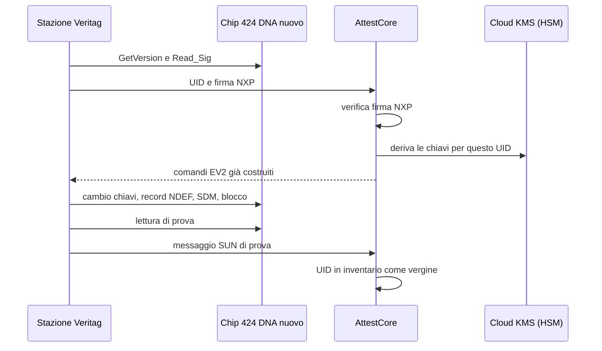
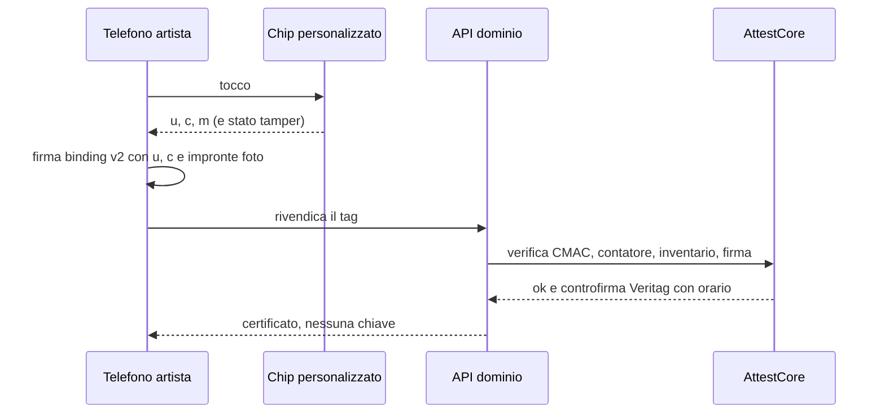

# Piano: chiavi, legame con l'opera e verifica senza il nostro server

> **Stato:** proposta da discutere. Questo documento non cambia il codice: descrive
> cosa fare, in che ordine e come verificare che sia fatto.

## Da dove nasce

Il piano risponde, punto per punto, a questa richiesta:

> Chiavi e crittografia
>
> Usate i messaggi SUN/SDM con firma CMAC e contatore? Il backend rifiuta una lettura con un contatore già visto?
>
> Le chiavi sono diverse per ogni tag (derivate dall'identificativo del chip) o è una sola per tutti?
>
> Dove sono le chiavi master (HSM o servizio di gestione chiavi, variabili d'ambiente, database) e chi vi accede? Le chiavi di fabbrica del chip sono state cambiate?
>
> Verificate anche la firma di originalità NXP, per escludere emulatori o chip non autentici?
>
> Dopo la programmazione, le impostazioni del chip sono bloccate in scrittura?
>
> Legame tag–opera
>
> 6. Che inlay usate e come lo montate: si rompe se lo stacchi o si sposta intatto su un'altra opera?
> 7. C'è un legame fisso tra tag e opera (foto, impronta dell'immagine) che impedisca di riassegnare un tag?
>
> Verifica senza il vostro server
>
> 8. Se il servizio chiude, l'opera resta verificabile? Il certificato ha una firma a chiave pubblica verificabile offline?
> 9. Il link nel chip punta a un vostro dominio: cosa succede se scade?
>
> Supporti e processo
>
> 10. Avete provato la lettura su dibond, alluminio, dietro vetro e in cornice?
> 11. Chi programma i chip (voi, l'artista, il fornitore) e come si impedisce che altri creino tag "validi" con le vostre chiavi?
>
> Le domande 3, 6 e 8 sono le più importanti: coprono i punti in cui il Bubble Tag è ancora più forte del chip.

Nel resto del documento le domande sono numerate da 1 a 11 nell'ordine sopra.
I punti 3, 6 e 8 sono quelli che decidono le priorità.

## Fonti e limiti

- Codice di questo repo (app mobile e portale curatori) al commit `d5e402f`.
- Schema OpenAPI pubblico delle due API in produzione (`api.veritag.art` e
  AttestCore), letto il 2026-10-28 con sole richieste GET.
- **Non letti:** `veritag-core` (AttestCore e API di dominio) e `veritag-sdk`.
  Ciò che dipende da quel codice è marcato **[da verificare]** e raccolto nella
  Fase 0.

## Sintesi

| # | Domanda | Oggi | Obiettivo | Fase |
|---|---|---|---|---|
| 1 | SUN/SDM, CMAC, contatore | Sì: UID e contatore in chiaro più CMAC; anti-replay "atomico" in AttestCore, regola esatta [da verificare] | Contatore strettamente crescente per UID | 0 |
| 2 | Chiave per tag o unica | Una chiave per tag, ma generata come? [da verificare] | Derivata dall'UID da una master; nessuna chiave per tag salvata | 1 |
| **3** | **Dove sono le master, chi accede, chiavi di fabbrica** | **La chiave del tag esce dal backend e arriva al telefono; chiave 0 probabilmente ancora di fabbrica** | **Master in Cloud KMS (livello HSM); chiavi mai fuori dal backend; tutte e 5 le chiavi del chip cambiate in ambiente controllato** | **1** |
| 4 | Firma di originalità NXP | Nessuno la verifica | Verificata e salvata alla personalizzazione; leggibile offline | 1 |
| 5 | Impostazioni bloccate | No: "Erase a tag" funziona senza chiavi | Impostazioni congelate, chiave 0 segreta | 1 |
| **6** | **Inlay e montaggio** | **Nessun rilevamento: il tag si sposta intatto** | **NTAG 424 DNA TT con stato di manomissione nel messaggio SUN; montaggio distruttivo** | **2** |
| 7 | Legame fisso tag–opera | Firma su UID + titolo + artista; foto non firmata; riassegnazione prevista | Binding v2 con impronte delle foto; un UID si lega una volta sola | 2 |
| **8** | **Verificabile se chiudiamo** | **No; e se un artista cancella l'account, tutte le sue opere smettono di risultare autentiche** | **Certificato firmato verificabile offline; le opere già firmate restano valide** | **3** |
| 9 | Dominio | Record NDEF di tipo esterno `arttrust.com:t`; API su `api.veritag.art`; niente iOS | Scelta record/URL; dominio a lungo termine; endpoint di riserva | 3 |
| 10 | Supporti | Nessuna prova documentata | Matrice di test con soglie | 2 |
| 11 | Chi programma, chi può creare tag "validi" | L'artista dal telefono; registrazioni aperte; UID non dimostrato | Veritag personalizza; l'artista rivendica un tag con prova live | 1 |

## Cosa abbiamo trovato (in breve)

Dettagli e prove, per riferimento:

- **La chiave del tag arriva al telefono.** `POST /artworks` restituisce
  `chip_key_hex` ([`api_client.dart:64`](../mobile-app/lib/api_client.dart#L64)) e
  l'app la scrive nel chip ([`main.dart:649`](../mobile-app/lib/main.dart#L649)).
  Chi ha coniato un tag può clonarlo con un emulatore che calcola CMAC validi.
- **Chiunque può ottenere una chiave valida.** `POST /artists` non richiede
  autenticazione e `POST /artworks` accetta un `uid` dichiarato dal client, senza
  prova che il chip esista.
- **Chiave 0 probabilmente di fabbrica.** "Erase a tag"
  ([`main.dart:1342`](../mobile-app/lib/main.dart#L1342)) disattiva SDM e azzera
  l'NDEF senza chiedere chiavi al server. Se funziona su un tag firmato, la chiave
  0 è quella di fabbrica oppure una costante dentro l'APK.
- **Riassegnazione prevista.** Il testo dell'app dice che il chip "can be signed
  again" ([`main.dart:1327`](../mobile-app/lib/main.dart#L1327)).
- **Il binding firmato non contiene la foto:** è
  `SHA-256(uid ‖ 0x1f ‖ titolo ‖ 0x1f ‖ artist_id)`
  ([`binding.dart`](../mobile-app/lib/binding.dart)).
- **Nessuna verifica offline.** Il CMAC è simmetrico; la firma dell'artista non
  è sul chip e l'API non la restituisce. `POST /artists/{id}/erase` revoca
  l'emittente: "their chips stop vouching for anyone".
- **Tocco ad app chiusa senza controllo del chip.** Il payload di qualunque tag
  col record viene letto ([`main.dart:137`](../mobile-app/lib/main.dart#L137)); un
  payload senza CMAC mostra "On record" in oro con la foto dell'opera.
- **Minori:** traffico in chiaro permesso nella build di release
  ([`AndroidManifest.xml:14`](../mobile-app/android/app/src/main/AndroidManifest.xml#L14));
  credenziali demo sulla pagina di login del portale
  ([`App.tsx:95`](../web-portal/src/App.tsx#L95)). In produzione esiste solo il
  curatore "Exteryo", quindi non sono sfruttabili, ma la scritta va tolta.

## Il cambio di fondo

Oggi l'artista programma il chip dal telefono, e per farlo il telefono riceve la
chiave. Anche se il server guidasse la sessione e il telefono facesse solo da
tramite, il problema resterebbe: **la prima autenticazione usa la chiave 0 di
fabbrica, nota a tutti**. Chi fa da tramite in quel momento può decifrare i
comandi e leggere le nuove chiavi. Quindi:

1. **Personalizzazione in ambiente controllato.** Veritag (o un fornitore sotto
   contratto, decisione D2) cambia tutte le chiavi, scrive il record, attiva SDM
   e blocca le impostazioni. Il chip esce "vergine ma sigillato".
2. **Rivendicazione dal telefono.** L'artista non scrive più nulla sul chip: lo
   tocca, l'app invia il messaggio SUN appena letto (`u`, `c`, `m`) insieme alla
   firma del binding. Il server verifica il CMAC e così sa che il chip è vero, è
   presente ed è stato personalizzato da noi. Nessuna chiave lascia il backend.

## Fase 0 — subito, senza hardware nuovo

### Verifiche nel codice di `veritag-core` e `veritag-sdk`

| | Cosa verificare | Perché conta |
|---|---|---|
| V1 | La regola anti-replay: "contatore maggiore dell'ultimo visto" o "mai visto"? | Con "mai visto", chi legge il tag in galleria senza inviare la lettura ottiene messaggi validi per sempre (punto 1) |
| V2 | Come nasce `chip_key_hex`: casuale e salvata, o derivata da una master? Dove sta la master? | Punti 2 e 3 |
| V3 | Cosa fa `provisionSdm`: quali chiavi cambia, quali diritti di accesso imposta | Punti 3 e 5 |
| V4 | Prova pratica: firmare un tag, poi Impostazioni → Erase a tag | Se lo cancella, la chiave 0 non è segreta (punto 5) |
| V5 | Un secondo `POST /artworks` sullo stesso UID: rifiutato, sovrascritto, duplicato? | Riassegnazione (punto 7) |
| V6 | Significato di `expires_in` nella risposta di conio | Capire se esiste già una finestra di provisioning |
| V7 | Dove l'API di dominio conserva i token degli emittenti per AttestCore | Chi può chiedere provisioning (punto 11) |
| V8 | Se `POST /curators` è davvero aperto in produzione | Se sì, la spunta blu si può autoassegnare (punto 11) |

### Interventi rapidi

- **Anti-replay monotono** (AttestCore): accettare solo `c` maggiore dell'ultimo
  valore per quell'UID, in un unico aggiornamento atomico
  (`UPDATE … SET last_ctr = :c WHERE uid = :u AND last_ctr < :c`).
- **Un UID, un conio:** un secondo conio sullo stesso UID risponde 409, sempre.
- **Togliere "Erase a tag"** dalla build pubblica dell'app (resta, se serve, solo
  nella stazione di personalizzazione).
- **Registrazione curatori su invito**, approvata da Veritag; togliere le
  credenziali demo dalla pagina di login.
- **Verdetto verde solo con spunta blu** (decisione D6): oggi "Authentic" vale
  anche per un artista registrato da sé con un nome qualsiasi.
- **Niente "On record" dorato per un tag toccato senza prova valida:** se il tag
  fisico non ha dato un CMAC valido, il passaporto mostra un avviso, non la scheda
  dell'opera come se fosse a posto.
- **Cancellazione dell'account artista senza revoca retroattiva:** si tolgono i
  dati personali, ma le opere già firmate restano valide; la revoca vale solo per
  il futuro.
- **Traffico in chiaro solo in debug**, tramite network security config.
- **Allarmi** su `replayed` e `counterfeit` ripetuti per lo stesso UID.

## Fase 1 — chiavi e personalizzazione (punti 2, 3, 4, 5, 11)

### 1.1 Master in Cloud KMS (punti 2 e 3)

- Una chiave HMAC-SHA256 con livello di protezione HSM nel progetto
  `veritag-502321`, una per ogni `key_version` (il campo `kv` esiste già nel
  protocollo, quindi la rotazione è prevista).
- Chiave del tag derivata dall'UID: i primi 16 byte di
  `HMAC(master_kv, "veritag/sdm" ‖ kv ‖ numero_chiave ‖ UID)`, cioè una KDF
  NIST SP 800-108, calcolata dentro KMS. In alternativa NXP AN10922 (AES-CMAC),
  se si sceglie un HSM che la supporta.
- Nessuna chiave per tag nel database. Al massimo una cache in memoria di breve
  durata dentro AttestCore.
- **Chi accede:** il permesso d'uso della chiave ce l'ha solo il service account
  di AttestCore. Chi amministra la chiave non può usarla. Nessuna persona ha il
  permesso d'uso; c'è una procedura di emergenza documentata che richiede due
  persone. Log di accesso KMS attivi e conservati.

### 1.2 Stazione di personalizzazione (punti 3, 4, 5, 11)

PC con lettore NFC USB, in sede Veritag (o dal fornitore, D2). Per ogni chip:

1. `GetVersion` e `Read_Sig`: la firma di originalità NXP (ECC sull'UID) viene
   verificata con la chiave pubblica NXP e salvata. Un chip che non passa viene
   scartato. **(punto 4)**
2. Autenticazione EV2 con la chiave 0 di fabbrica.
3. Cambio di **tutte e cinque** le chiavi con quelle derivate. **(punto 3)**
4. Scrittura del record NDEF modello e attivazione di SDM: UID, contatore, stato
   di manomissione (con inlay TT) e CMAC con una chiave dedicata.
5. Diritti di accesso: lettura libera; scrittura del file NDEF solo con chiave 0;
   modifica delle impostazioni ("Change") **mai**, dopo la validazione sui
   campioni (D3). **(punto 5)**
6. Lettura di prova: il messaggio SUN deve verificare su AttestCore.
7. Registrazione in inventario: UID, lotto, data, operatore, firma NXP, stato
   "vergine".

I comandi EV2 li costruisce AttestCore; la stazione fa da tramite e non conosce
la master. La stazione resta un punto sensibile perché vede la prima
autenticazione con la chiave di fabbrica: per questo è in ambiente controllato,
con accesso nominale e registro dei lotti.

### 1.3 Rivendicazione dal telefono (punti 4 e 11)

- L'app legge `u`, `c`, `m` (e lo stato di manomissione) e li invia con il
  binding v2 firmato, che include `u` e `c` di quella lettura: la firma vale solo
  per quel tocco.
- Il server accetta solo se: CMAC valido, contatore crescente, UID in inventario
  e vergine, firma dell'artista valida. Poi lega in modo atomico e controfirma
  con la chiave Veritag (Cloud KMS, EC P-256) e un orario.
- **Nessuna risposta contiene materiale di chiave:** via `chip_key_hex` da
  `MintArtworkOut` e `ProvisionOut`, via `provisionSdm` dall'SDK.
- Un emulatore non può produrre un CMAC valido senza la chiave: un chip inventato
  o copiato non passa la rivendicazione né la verifica.

### 1.4 Ritiro di un tag (punto 5)

Sul campo non si cancella più nulla. Un tag si ritira lato server (stato
"ritirato" in inventario, verdetto "ritirato"), con revoca firmata dall'artista e
da Veritag. Un UID ritirato non si lega più. L'opzione LRP del 424 DNA (D4) è
irreversibile: si valuta dopo i test di compatibilità.

### 1.5 Tag già in circolazione

- Censimento dei binding esistenti: quanti, di quali artisti.
- Nel passaporto: etichetta "tag di prima generazione, protezione ridotta"
  finché non vengono migrati.
- Migrazione: il tag passa dalla stazione (se la chiave 0 è ancora di fabbrica
  si può personalizzare) e l'artista lo rivendica con il binding v2. Altrimenti
  si sostituisce.

### Criteri di accettazione della Fase 1

- Su un tag personalizzato, l'autenticazione EV2 con la chiave 0 di fabbrica
  fallisce.
- `ChangeFileSettings` risponde "permesso negato", anche con la chiave 0 giusta.
- Né l'app né NXP TagXplorer riescono a cancellare o riscrivere il record.
- Rivendicazione rifiutata con UID non in inventario, con `u`/`c`/`m` non validi,
  o su un UID già legato (409).
- Un test automatico sullo schema OpenAPI fallisce se una risposta contiene
  campi di chiave.
- Un emulatore con UID e firma NXP copiati da un chip vero non ottiene
  "autentico".

## Fase 2 — legame fisico con l'opera (punti 6, 7, 10)

### 2.1 Inlay e montaggio (punto 6)

- **NTAG 424 DNA TT** (TagTamper): un anello conduttivo attraversa l'adesivo; se
  si rompe, il chip lo registra in modo permanente e lo inserisce nel messaggio
  SUN. Il payload passa a `v2` con il campo dello stato; il server, se l'anello è
  aperto, dà il verdetto **"manomesso"**, per sempre.
- Substrato frangibile e adesivo permanente: staccandolo si rompono antenna o
  anello.
- Su metallo (dibond, alluminio) serve un inlay "on-metal" con ferrite. Va
  verificato con il fornitore che esista in versione TT [da verificare].
- Procedura di montaggio scritta, per tipo di supporto: posizione standard (per
  esempio retro del telaio), foto macro del tag montato con quello che lo
  circonda (trama, firma, timbri), foto fronte e retro dell'opera. Le foto si
  scattano nell'app durante la rivendicazione.

### 2.2 Binding v2 (punto 7)

- Struttura firmata con codifica canonica (JSON canonico RFC 8785 o CBOR
  deterministico) al posto della concatenazione con `0x1f`.
- Contenuto: versione, UID, `kv`, contatore e CMAC del tocco di rivendicazione,
  `artist_id`, titolo, anno, tecnica, dimensioni, **SHA-256 di ogni foto**
  (fronte, retro, tag montato), data.
- Firma dell'artista (P-256, già nel Keystore del telefono) e controfirma
  Veritag con orario.
- Foto salvate per impronta su Cloud Storage con retention lock: non si
  modificano. Oggi la foto è un campo del database che chi lo controlla può
  cambiare.
- **Un UID si lega una volta sola.** Le revoche finiscono in un registro in sola
  aggiunta.
- Aggiornare i vettori di conformità in Dart, TypeScript e Python. Il binding v1
  resta verificabile per i tag vecchi.

### 2.3 Test sui supporti (punto 10)

Matrice: supporti (tela su telaio, carta in cornice, dietro vetro, dietro
plexiglass, dibond, alluminio, acciaio, ceramica) × inlay (standard, on-metal,
TT) × telefoni (almeno 5 Android di fasce diverse, più iPhone quando ci sarà
l'app). Si misurano la distanza di lettura, le letture riuscite su 20 tocchi e il
tempo fino al verdetto. Lo strumento è il "Tag doctor" dell'app. Risultati in
`docs/test-supporti.md`. Una combinazione è dichiarata supportata solo con
almeno il 95% di letture riuscite.

### Criteri di accettazione della Fase 2

- Un tag TT staccato dà "manomesso" al tocco successivo, anche se rimontato.
- Una foto cambiata nell'archivio fa fallire la verifica del certificato.
- Il secondo legame sullo stesso UID è rifiutato.

## Fase 3 — verificabile senza di noi (punti 8, 9)

### 3.1 Certificato verificabile offline (punto 8)

- **Contenuto:** binding v2, firma dell'artista, controfirma Veritag (e del
  curatore, se c'è), chiavi pubbliche, firma di originalità NXP del chip.
- **Formato:** JSON firmato (JWS o COSE) dentro un PDF/A con QR, consegnato al
  proprietario e sempre scaricabile.
- **Verificatore open source:** una pagina HTML statica che funziona anche
  salvata in locale, più lo stesso modulo nell'app. Controlla le firme, ricalcola
  le impronte delle foto, legge dal chip UID e firma NXP e li confronta con il
  certificato.
- **Chiavi pubbliche pubblicate** in più posti: un file `.well-known` su
  `veritag.art`, un repo pubblico, stampate nel certificato.
- **Limite onesto:** offline si dimostra "chip NXP genuino con questo UID, legato
  a quest'opera dall'artista e registrato da Veritag". La prova contro i cloni
  (CMAC e contatore) resta online, perché è simmetrica. Lo stato di manomissione
  letto offline è indicativo, non autenticato.

### 3.2 Continuità (punto 8)

- **Account artista cancellato:** si tolgono o pseudonimizzano i dati personali,
  ma restano chiave pubblica e binding. La controfirma con orario distingue le
  opere firmate prima della revoca da quelle dopo.
- **Telefono dell'artista perso:** nuova chiave registrata con una nuova
  verifica del curatore; le opere precedenti restano valide.
- **Chiusura del servizio (D5):** impegno contrattuale a pubblicare il registro
  dei binding e le chiavi pubbliche. Per mantenere anche la verifica anti-clone,
  la master va depositata presso un terzo (per esempio un notaio), divisa in
  quote, da consegnare a un successore designato. In alternativa si accetta che,
  dopo la chiusura, resti solo la verifica offline.
- AttestCore e verificatore open source, così un successore può rimetterli in
  piedi.

### 3.3 Dominio e record (punto 9)

- Oggi il chip non contiene un link ma un record di tipo esterno
  `arttrust.com:t` ([`AndroidManifest.xml:44`](../mobile-app/android/app/src/main/AndroidManifest.xml#L44)).
  Quel dominio è solo un nome, senza DNS: se scade non si rompe nulla. Nella
  personalizzazione v2 diventa `veritag.art:t`; l'app continua ad accettare il
  vecchio.
- Ciò che dipende dal dominio è l'API: `https://api.veritag.art` è il predefinito
  dell'app ([`main.dart:33`](../mobile-app/lib/main.dart#L33)) e del portale.
  Servono: rinnovo per 10 anni con rinnovo automatico, blocco al registrar, due
  amministratori, DNSSEC. L'app prova una lista di endpoint di riserva e la
  aggiorna con una configurazione firmata.
- Aggiungere un Android Application Record: chi non ha l'app viene mandato allo
  store invece di non vedere nulla.
- **Decisione D1:** restare con il record esterno (nessun browser, ma serve
  l'app; su iPhone non funziona senza un'app iOS) oppure passare a un URL https
  con App Links e Universal Links (si apre su qualsiasi telefono; senza app apre
  una pagina di verifica, ma il dominio diventa critico).
- **App iOS:** Core NFC legge il 424 DNA. Serve sia per verificare sia per
  rivendicare da iPhone.

## Dopo il piano: i punti 3, 6 e 8 a confronto con il Bubble Tag

| Punto | Bubble Tag | Chip oggi | Chip dopo il piano |
|---|---|---|---|
| 3 · chiavi | Nessuna chiave da proteggere: la sicurezza sta nel sigillo fisico | Chiave del tag sul telefono, chiave 0 probabilmente di fabbrica | Chiavi solo in KMS/HSM, chip sigillati, emulatori respinti |
| 6 · montaggio | Si distrugge se rimosso | Si sposta intatto senza lasciare traccia | Il distacco lascia una traccia permanente nel chip, verificata a ogni tocco |
| 8 · offline | Il sigillo si confronta a occhio con l'immagine registrata | Nulla | Certificato firmato e firma NXP verificabili offline; anti-clone solo online |

Dopo il piano il chip raggiunge il Bubble Tag sui punti 3 e 6. Sul punto 8 il
Bubble Tag resta più forte: una verifica visiva senza elettronica non ha
equivalenti per il chip. Se l'obiettivo è la parità anche lì, l'opzione D7 è
affiancare al chip un sigillo fisico non riproducibile e mettere l'impronta della
sua immagine dentro il binding v2.

## Decisioni da prendere

| | Decisione | Opzioni |
|---|---|---|
| D1 | Cosa scrive il chip | Record esterno (solo app) · URL https con App Links / Universal Links |
| D2 | Chi personalizza | In sede Veritag · fornitore con iniezione chiavi sotto contratto |
| D3 | Blocco delle impostazioni | Definitivo ("Change" mai) · modificabile solo con chiave 0 |
| D4 | Modalità LRP del 424 DNA | Sì (irreversibile) · no |
| D5 | Se il servizio chiude | Deposito della master presso un terzo · solo verifica offline |
| D6 | Conio per artisti senza spunta blu | Vietato · permesso con verdetto non verde |
| D7 | Sigillo fisico accanto al chip | Sì · no |

## Dove si lavora

| Repo / ambito | Interventi |
|---|---|
| `veritag-app` (questo) | Togliere Erase; verdetti e avvisi del passaporto; rivendicazione v2 e foto di montaggio; verificatore del certificato; traffico in chiaro solo in debug; record `veritag.art:t` e Android Application Record; endpoint di riserva; app iOS |
| `veritag-sdk` | Via `provisionSdm` e la scrittura di chiavi dal telefono; payload v2 con stato di manomissione; binding v2 e vettori; `Read_Sig`; verifica del certificato |
| `veritag-core` · AttestCore | KMS e derivazione; anti-replay monotono; API della stazione; inventario; rivendicazione; controfirma; nessuna chiave nelle risposte |
| `veritag-core` · API di dominio | Curatori su invito; un UID un conio; conio legato alla spunta blu (D6); cancellazione artista senza revoca retroattiva; certificato; archivio foto immutabile |
| Operativo | Stazione e registro lotti; procedura di montaggio; test sui supporti; dominio; deposito della master (D5) |

## Ordine

1. **Fase 0** subito: le verifiche V1–V8 decidono quanto lavoro serve nelle fasi
   successive, e gli interventi rapidi chiudono i buchi più evidenti senza
   hardware nuovo.
2. **Fase 1** prima di distribuire altri tag: finché la chiave passa dal
   telefono, ogni nuovo tag è un tag di prima generazione da migrare.
3. **Fase 2** in parallelo, appena scelto l'inlay: i test sui supporti dipendono
   dal fornitore.
4. **Fase 3** dopo la Fase 2, perché il certificato contiene il binding v2.
